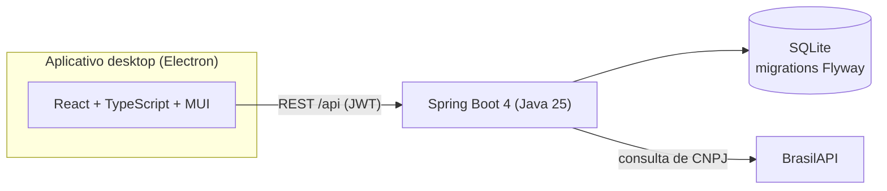

# Hort Sistema

Sistema de gestão para atacado de hortifrúti: pedidos de compra e venda, estoque com custo por lote (FIFO), controle de fiado e painel financeiro. É um aplicativo desktop que funciona offline, com os dados num banco local.

Projeto individual. Java 25, Spring Boot 4, SQLite, React 19 e Electron.


## O problema

Quem compra e vende hortifrúti em volume costuma controlar tudo em caderno ou planilha. O estoque nunca fecha com o que está no galpão, e o lucro de uma venda é um palpite, porque o mesmo produto entra várias vezes ao longo do mês por preços diferentes. O fiado piora: a nota é anotada, o cliente paga uma parte depois, e ninguém sabe ao certo quais notas já foram quitadas.

O Hort resolve esses três pontos: o custo de cada venda é calculado a partir do lote que foi realmente consumido, o estoque é consequência dos pedidos (nunca editado à mão) e o pagamento parcial de fiado abate as notas em ordem.

## O que faz

- **Pedidos de compra e venda.** Cada pedido tem uma natureza de operação (venda, compra, quebra, ajuste de entrada ou uma criada pelo usuário). A natureza define se o pedido exige cliente, valor unitário e status de pagamento, então uma quebra de mercadoria não pede cliente e uma venda pede.
- **Estoque com rastreabilidade.** O estoque atual é calculado pelas movimentações. Cada produto tem uma linha do tempo, e cada movimentação leva ao pedido que a originou, com o item destacado.
- **Custo por lote (FIFO).** Compras criam lotes com o custo exato daquela entrada. Vendas consomem do lote mais antigo, e o custo e a margem de cada item ficam registrados.
- **Clientes e fiado.** Cadastro de pessoa física e jurídica, histórico cronológico de pedidos, dívida total e abatimento. Um pagamento parcial quita as notas pendentes da mais antiga para a mais nova; se o valor não cobre a próxima nota inteira, ele vira crédito do cliente.
- **Painel.** Total vendido, produto mais vendido, clientes mais fiéis e mais lucrativos, com filtro de período (hoje, últimos 7 dias, mês, mês anterior, ano e ano anterior).
- **Conta por CNPJ.** No cadastro, a razão social e o nome fantasia vêm da [BrasilAPI](https://brasilapi.com.br).

## Decisões de projeto

**Local-first.** O objetivo é rodar na máquina do dono do negócio, sem servidor e sem depender de internet para operar. Por isso SQLite, com o schema versionado pelo Flyway, e um Electron que empacota a interface e sobe o backend como processo filho.

**Estoque é derivado, não editável.** O cadastro de produto não aceita quantidade. Todo movimento de estoque exige uma natureza de operação e, quando há pedido, aponta para ele. Isso é o que permite reconstruir qualquer saldo e a timeline.

**FIFO modelado em tabelas.** `lote_entrada` guarda a quantidade original, a disponível e o custo congelado de cada compra; `lote_saida` registra quanto de cada lote cada venda consumiu e a que custo. O custo unitário do item de venda é a média ponderada dos lotes consumidos. A lógica está em `FifoService`, com testes unitários e de integração.

**Exclusão lógica.** Produtos, clientes e pedidos não são apagados; são inativados ou cancelados, para o histórico financeiro continuar íntegro.

**Autenticação simples e local.** Login por e-mail e senha, com BCrypt e token JWT. Como o app roda na máquina do usuário, a segurança é pensada para proteger os dados locais, não para exposição na internet.

## Arquitetura



No backend, as camadas seguem a divisão usual: `controller` (HTTP), `service` (regras e transações, incluindo `FifoService`, `EstoqueService` e `PedidoService`), `repository` (Spring Data JPA) e `model`. O modelo de dados original está em [docs/REQUISITOS.md](docs/REQUISITOS.md).

## Rodando em desenvolvimento

Precisa de JDK 25 e Node. O backend e o frontend sobem separados.

```bash
# terminal 1: API em localhost:8080
cd backend
./mvnw spring-boot:run

# terminal 2: interface (Vite + Electron)
cd frontend
npm install
npm run electron:dev
```

O banco é criado em `backend/data/` na primeira execução, com as migrations aplicadas. Sem dados, o painel aparece vazio.

Para ver o sistema com movimento, suba o backend com o perfil `demo`:

```bash
./mvnw spring-boot:run -Dspring-boot.run.profiles=demo
```

Isso cria um banco separado (`data/hort_demo.db`) com uma loja fictícia: 8 produtos, 6 clientes e cerca de 30 dias de compras, vendas, fiado e quebras, gerados pelos mesmos serviços da aplicação. Login: `demo@hort.dev` / `demo1234`.

## Testes

```bash
cd backend
./mvnw verify
```

São 267 testes (services, controllers, a integração do FIFO e um teste de desempenho), com cobertura de cerca de 76% medida pelo JaCoCo. O relatório sai em `backend/target/site/jacoco`.

## Estado atual e próximos passos

- Não há instalador publicado. O `electron:build` gera o pacote, mas ele ainda depende de Java instalado na máquina; o passo seguinte é embutir um runtime com `jlink`.
- O projeto não foi usado em produção; foi modelado a partir de um caso real de atacado de hortifrúti.
- Edição de pedido já emitido e devolução (além de cancelamento) estão na lista de ideias, ainda sem implementação. A lista completa está em [docs/FEATURES.md](docs/FEATURES.md).
